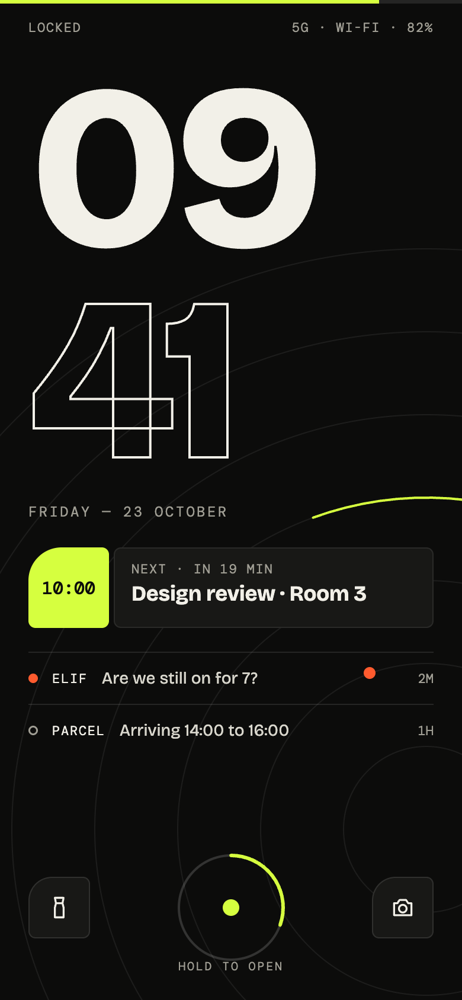
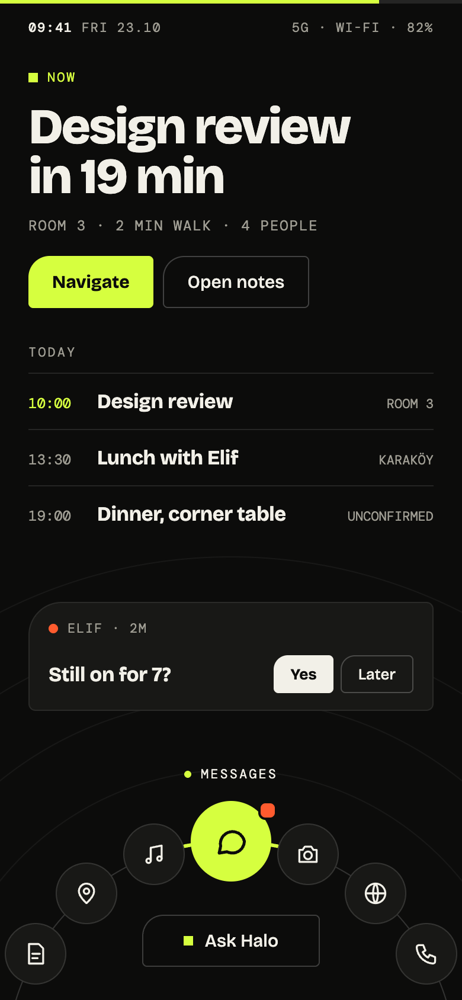
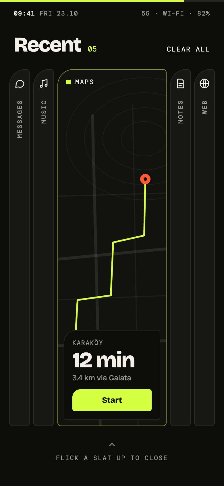
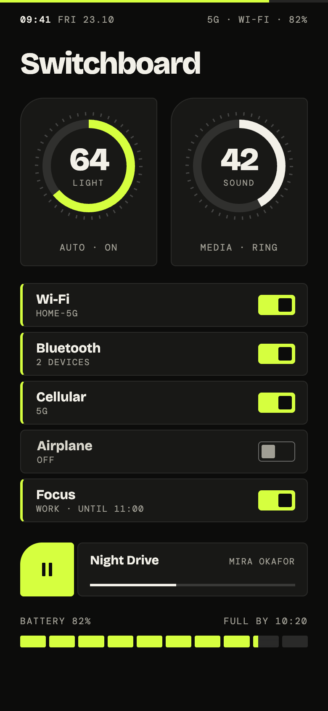
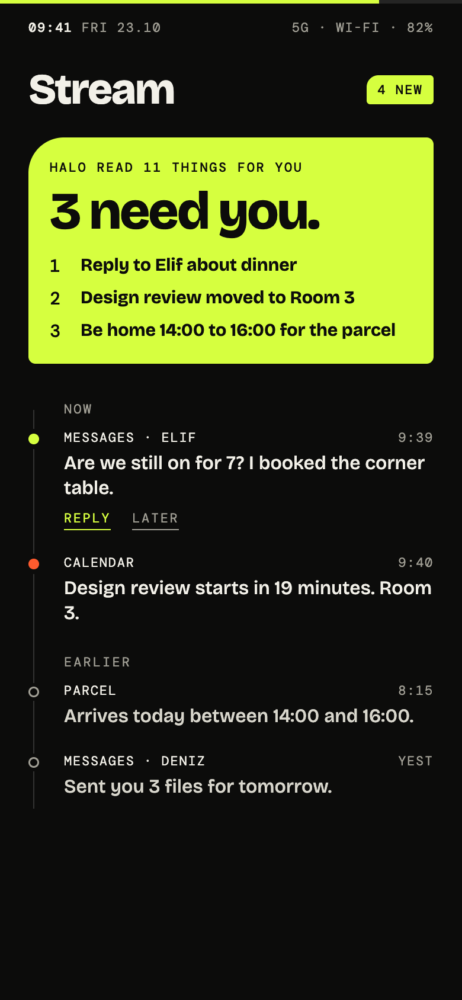
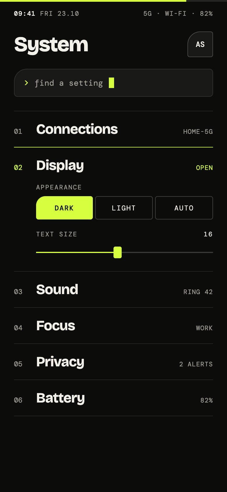

# Halo OS

A mobile operating system built from scratch on the Linux kernel, with a Flutter shell and Flutter apps. It uses no distribution underneath.

> No grid · No glass · No dock.

Halo puts what matters now at the top of the screen and your apps on an arc in thumb reach. Notifications become one stream that Halo summarizes. Controls look like controls.

| Lock | Home | Recents | Switchboard | Stream | System |
|---|---|---|---|---|---|
|  |  |  |  |  |  |

## Status

Pre-alpha. Only the design and the documentation exist so far. See [ROADMAP.md](ROADMAP.md).

## Documentation

- [ROADMAP.md](ROADMAP.md): phases and exit criteria
- [docs/ARCHITECTURE.md](docs/ARCHITECTURE.md): boot chain, compositor, services, IPC, security
- [docs/DESIGN_SYSTEM.md](docs/DESIGN_SYSTEM.md): tokens, components, screens
- [docs/BUILD.md](docs/BUILD.md): toolchain, build pipeline, targets
- [docs/DECISIONS.md](docs/DECISIONS.md): decision log
- [CLAUDE.md](CLAUDE.md): working guide for AI agents and contributors

## Stack at a glance

Linux (mainline LTS) → `haloinit` (Rust, PID 1) → system services (Rust, protobuf over Unix sockets) → `halo-compositor` (Rust/Smithay, Wayland) embedding the Flutter shell → apps as sandboxed Flutter Wayland clients.
